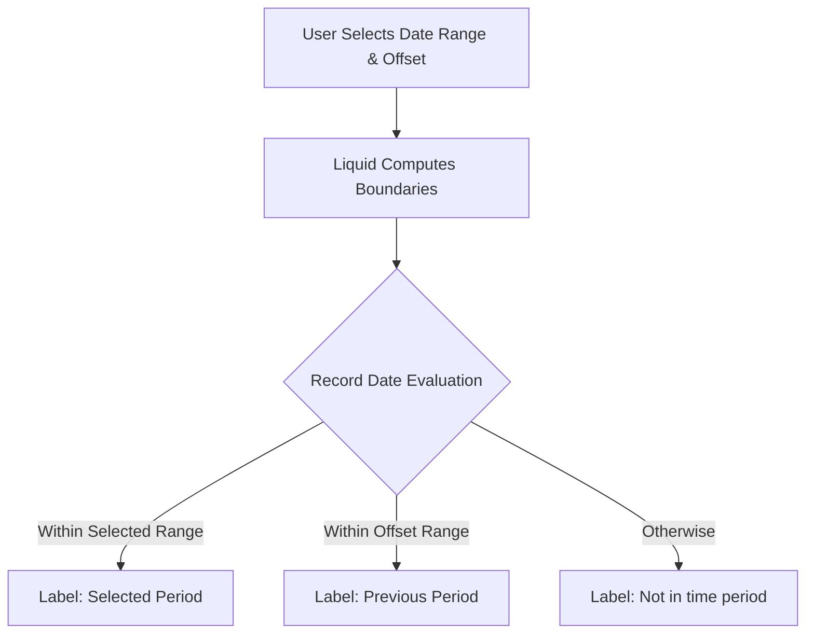

# Advanced Period-over-Period (PoP) Engine

This reference handbook details the standard pattern for implementing a high-performance, single-view Period-over-Period (PoP) engine in Looker. It allows business users to dynamically compare metrics across flexible timeframes (Yesterday, Week, Month, Year, or custom intervals) without duplicating views or executing self-joins.

---

## 1. Core Architecture

The single-explore PoP engine relies on:
1. A user-facing **Control Date Filter** (`pop_date_filter`) selecting the current date range.
2. A user-facing **Comparison Period Parameter** (`pop_compare_to`) selecting the comparison offset.
3. Liquid-templated `case:` logic labeling rows as `'Selected Period'`, `'Previous Period'`, or `'Not in time period'`.



---

## 2. LookML Implementation

Add these fields to your refined view (`views/refined/<view>_rfn.view.lkml`), placing dimensions, measures, and filters/parameters in their respective functional sections (`1. Keys -> 2. Dimensions -> 3. Measures -> 4. Filters & Parameters -> 5. Sets`).

### Step 1: User Inputs (Place in Section 4: Filters & Parameters)
```lookml
filter: pop_date_filter {
  view_label: "_PoP"
  label: "Comparison Date Filter"
  description: "Select the current date range to compare against the previous period."
  type: date
  default_value: "7 days"
}

parameter: pop_compare_to {
  view_label: "_PoP"
  label: "Compare To"
  description: "Select the offset interval for the previous period comparison."
  type: string
  allowed_value: { value: "Yesterday" }
  allowed_value: { value: "Week" }
  allowed_value: { value: "Month" }
  allowed_value: { value: "Year" }
  default_value: "Year"
}
```

### Step 2: Hidden Helper Dimensions (Place in Section 2: Dimensions)
Reference the base date dimension via `${created_date}` (Rule 5 substitution, avoiding `DATE(CAST(col AS DATE))` double-casting crashes) and align `DATE` types across `CASE` branches:

```lookml
dimension: pop_data_date {
  hidden: yes
  type: date
  datatype: date
  sql: ${created_date} ;;
}

dimension_group: pop_filter_start {
  hidden: yes
  type: time
  datatype: date
  timeframes: [raw, date]
  sql: CASE WHEN  IS NULL THEN CAST('1970-01-01' AS DATE) ELSE CAST( AS DATE) END ;;
}

dimension_group: pop_filter_end {
  hidden: yes
  type: time
  datatype: date
  timeframes: [raw, date]
  sql: CASE WHEN  IS NULL THEN CURRENT_DATE ELSE CAST( AS DATE) END ;;
}
```

---

## 3. Multi-Dialect SQL Boundary Dimensions

### Dialect A: Google BigQuery & Cloud Spanner (GoogleSQL)
```lookml
dimension: pop_interval_days {
  hidden: yes
  type: number
  sql: DATE_DIFF(${pop_filter_end_date}, ${pop_filter_start_date}, DAY) ;;
}

dimension: pop_previous_start_date {
  hidden: yes
  type: date
  datatype: date
  sql:
    DATE_SUB(${pop_filter_start_date}, INTERVAL
       1 DAY
       1 WEEK
       1 MONTH
       1 YEAR
       ${pop_interval_days} DAY
      
    ) ;;
}
```

### Dialect B: Snowflake
```lookml
dimension: pop_interval_days {
  hidden: yes
  type: number
  sql: DATEDIFF('day', ${pop_filter_start_date}, ${pop_filter_end_date}) ;;
}

dimension: pop_previous_start_date {
  hidden: yes
  type: date
  datatype: date
  sql:
    DATEADD(
       'day', -1
       'week', -1
       'month', -1
       'year', -1
       'day', -${pop_interval_days}
      ,
      ${pop_filter_start_date}
    ) ;;
}
```

### Dialect C: Amazon Redshift & PostgreSQL
```lookml
dimension: pop_interval_days {
  hidden: yes
  type: number
  sql: DATEDIFF(day, ${pop_filter_start_date}, ${pop_filter_end_date}) ;;
}

dimension: pop_previous_start_date {
  hidden: yes
  type: date
  datatype: date
  sql:
    DATEADD(
       day, -1
       week, -1
       month, -1
       year, -1
       day, -${pop_interval_days}
      ,
      ${pop_filter_start_date}
    ) ;;
}
```

---

## 4. Period Evaluator & Scorecard KPI Measures

### Period Group Dimension (Section 2: Dimensions)
```lookml
dimension: pop_period_group {
  view_label: "_PoP"
  label: "Comparison Period"
  description: "Categorizes records into Selected Period, Previous Period, or Not in time period."
  type: string
  case: {
    when: {
      sql: ${pop_data_date} > ${pop_filter_start_date} AND ${pop_data_date} <= ${pop_filter_end_date} ;;
      label: "Selected Period"
    }
    when: {
      sql: ${pop_data_date} > ${pop_previous_start_date} AND ${pop_data_date} <= ${pop_filter_start_date} ;;
      label: "Previous Period"
    }
    else: "Not in time period"
  }
}
```

### Scorecard KPI Measures (Section 3: Measures)
Never attach `sql:` to `type: count` measures (Looker rejects `sql:` on `type: count`), and never reference an already-aggregated measure inside `type: sum`/`average` (reference the unaggregated base dimension via `${sale_amount}`).

```lookml
# Example A: Row-Count PoP Measures (omit sql: on type: count)
measure: orders_count_selected {
  view_label: "_PoP"
  label: "Orders Count (Selected Period)"
  description: "Total orders during the user-selected date range."
  type: count
  value_format_name: decimal_0
  filters: [pop_period_group: "Selected Period"]
}

measure: orders_count_previous {
  view_label: "_PoP"
  label: "Orders Count (Previous Period)"
  description: "Total orders during the previous comparison date range."
  type: count
  value_format_name: decimal_0
  filters: [pop_period_group: "Previous Period"]
}

measure: orders_count_pop_change {
  view_label: "_PoP"
  label: "Orders Count PoP % Change"
  description: "Percentage change in orders between selected and previous periods."
  type: number
  value_format_name: percent_1
  sql: 1.0 * (${orders_count_selected} - ${orders_count_previous}) / NULLIF(${orders_count_previous}, 0) ;;
  html:
    
      <span style="color: #0F9D58;">&#9650; {{ rendered_value }}</span>
    
      <span style="color: #DB4437;">&#9660; {{ rendered_value }}</span>
     ;;
}

# Example B: Sum/Currency PoP Measure (reference base dimension ${sale_amount})
measure: revenue_total_selected {
  view_label: "_PoP"
  label: "Revenue (Selected Period)"
  type: sum
  sql: ${sale_amount} ;;
  value_format_name: usd
  filters: [pop_period_group: "Selected Period"]
}
```

---

## 5. Development Checklist
- [ ] `pop_date_filter` and `pop_compare_to` are grouped under `view_label: "_PoP"` in Section 4.
- [ ] Helper boundary dimensions are `hidden: yes` with matching `DATE` types across `CASE` branches.
- [ ] `type: count` PoP measures omit `sql:`, while `type: sum` PoP measures reference unaggregated dimensions (`${field_name}`).
- [ ] Percent change measures (`<metric>_pop_change`) use `NULLIF(..., 0)` or `SAFE_DIVIDE` and `value_format_name: percent_1`.
