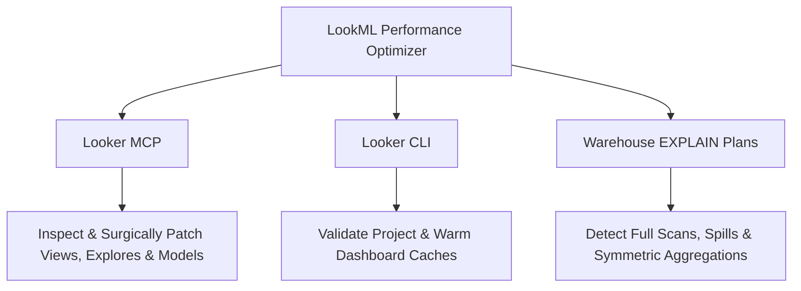

# LookML Performance Optimizer Guide

This human-facing guide accompanies [SKILL.md](../SKILL.md) inside `plugins/looker-lookml-modeling/skills/lookml-performance-optimizer/` and summarizes the 7-step LookML query optimization lifecycle.

Unlike greenfield scaffolding (`looker-architect`) or Conversational Analytics reasoning-trace tuning (`looker-ca-agent-optimize`), `lookml-performance-optimizer` focuses strictly on **warehouse SQL execution speed, compute cost reduction, datagroup cache alignment, and Persistent Derived Table (PDT) materialization**.

---

## 1. Specialized Reference Handbooks

- **[SKILL.md](../SKILL.md):** Core operating modes, guardrails, and the 4-Quadrant PDT Decision Matrix.
- **[query_diagnostic.md](query_diagnostic.md):** Parallel subagent SQL profiling, dialect `EXPLAIN` plan interpretation (BigQuery, Spanner, Snowflake), and the Symmetric Aggregations uniqueness audit.
- **[caching_datagroups.md](caching_datagroups.md):** Model-level `datagroup` policies, zero-cost catalog `sql_trigger` queries, cache-bypass parameters, and post-ETL cache warming.
- **[pdt_optimization.md](pdt_optimization.md):** Partitioning/clustering standards, incremental PDT configuration (`increment_key`, `increment_offset`), and the Cold-Start date-capping protocol.
- **[lookml_refactoring.md](lookml_refactoring.md):** Breaking up giant Explores, join pruning with `required_joins`, SARGable filter dimensions, and replacing Liquid `CASE WHEN` loops.

---

## 2. Stack Integration

---

## 3. The 7-Step Optimization Lifecycle

1. **Discovery & Baseline:** Switch to Developer Mode (`dev_mode`) and measure baseline query latency, generated SQL, and bytes/slots scanned.
2. **SQL & EXPLAIN Diagnostic Audit:** Analyze the execution plan and verify join-key uniqueness before altering `relationship:` parameters.
3. **Caching & ETL Alignment:** Replace arbitrary `persist_for` durations with centralized `datagroup` policies triggered by lightweight ETL/catalog metadata.
4. **PDT & Materialization Strategy:** Apply the 4-Quadrant Decision Matrix, configure partitioning/clustering, and protect initial incremental builds with Cold-Start caps.
5. **Semantic LookML Refactoring:** Prune joins, enforce SARGable filter columns, and eliminate heavy Liquid `CASE WHEN` loops.
6. **Compiler Validation & Delta Verification:** Run `validate_project` (and `looker-cli project validate`) to verify zero LookML syntax errors, then re-run baseline queries to confirm identical results and measurable speedup.
7. **Controlled Production Deployment:** Present the before/after performance delta and obtain explicit human confirmation before deploying to production.
